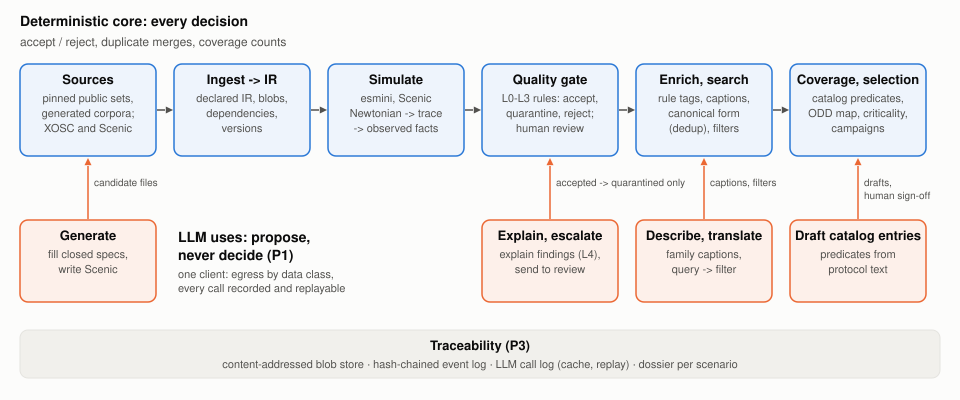

# LLMs Propose, Code Decides: A Traceable Scenario Database for Scenario-Based Testing of Automated Driving

**Berkay Taştan** · October 2026 · long version

**Read the paper:** [PDF](paper.pdf) · [on GitHub](paper.md)

Scenario-based testing of automated driving systems depends on scenario databases that reject
broken files, merge duplicates, explain what each scenario tests and show which required test
cases are missing. A recent survey names an LLM-assisted scenario database as an open problem.
This paper presents one in which LLMs propose and deterministic code decides: every acceptance,
rejection, merge and coverage count comes from rules, simulation and closed predicates, and every
LLM call is recorded. It is evaluated on up to 2 484 scenarios against Euro NCAP and UN R157
test protocols, with a fault-injection benchmark for the quality gate, generation for coverage
gaps, systems under test in simulation, and a small model fine-tuned on simulation-verified
examples.

## The system at a glance

*The deterministic core (top) makes every decision. LLMs (bottom) only feed proposals: candidate
files that go through the quality gate like any other, escalations that can only send a scenario
to human review, captions and search filters, and catalog drafts that a person signs off. Every
LLM call is recorded.*

## Highlights

- **Quality gate:** catches 79 % of injected faults with no false alarm on clean files
  (development split), and 89.6 % on a held-out split after targeted improvements. An LLM judge
  alone rejects 55 % of the clean files.
- **Generation:** LLMs writing raw OpenSCENARIO produce 0 usable files out of 80; filling a closed
  specification instead gives 37 of 40 scenarios that do what was asked.
- **Coverage:** gap filling completes the Euro NCAP frontal-collision test grid (328 of 328 cells).
- **Small model:** a 1.5-billion-parameter model fine-tuned only on simulation-verified examples
  goes from 0 to 18 of 40 unseen test items.

## Citation

> B. Taştan. LLMs Propose, Code Decides: A Traceable Scenario Database for Scenario-Based
> Testing of Automated Driving. 2026.

See also [`CITATION.cff`](CITATION.cff).

## License

The paper and its figures are licensed under
[Creative Commons Attribution 4.0 International (CC BY 4.0)](LICENSE).
