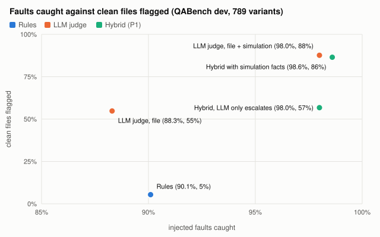
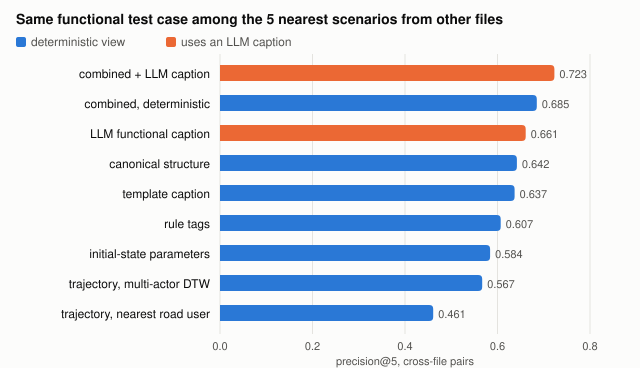
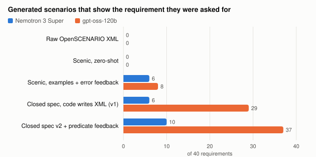

# LLMs Propose, Code Decides: A Traceable Scenario Database for Scenario-Based Testing of Automated Driving

**Berkay Taştan**

*October 2026. Long version. The implementation described here is not publicly released.*

## Abstract

Scenario-based testing of automated driving systems (ADS) depends on scenario databases that
accept files from many authors and generators, reject broken ones, merge duplicates, explain
what each scenario tests, and show which required test cases are missing. A recent survey of
large language models (LLMs) in scenario-based testing names such a database as an open
problem. We present a scenario database for ASAM OpenSCENARIO in which LLMs propose
and deterministic code decides. Every acceptance, rejection, merge and coverage count comes
from rules, simulation and closed predicates; an LLM may describe, search, generate parameters
and send a scenario to human review, and nothing more. Every LLM call is recorded and served
as a cache, files live in a content-addressed store, and state changes form a hash-chained
event log. We evaluate the design on 1 581 scenarios from three curated public sources and
seven generated corpora, and the format and system experiments on up to 2 484. On a
fault-injection benchmark, the rule gate catches 79 % of injected faults on the development
split with no false alarm on clean files; two changes, each measured on a held-out split frozen
beforehand, raise it to 85.2 % and 89.6 %. On the official ASAM example files, the gate held back
12 of the 13 scenarios of version 1.2, and the standard's own 1.3 revision changed 10 of them
in exactly the element the gate had flagged. An LLM judge alone catches 88 % but rejects 55 % of the
clean files; letting the LLM only escalate raises recall to 97 % at the cost of review load.
LLMs writing OpenSCENARIO XML produce 0 usable files out of 80. LLM-written Scenic programs,
given examples and the compiler's errors, mostly run but show the requirement they were asked
for in at most 8 of 40 cases. Filling a closed scenario specification instead gives 37 of 40,
and coverage-gap filling closes the Euro NCAP frontal-collision grid (328 of 328 cells).
Scenic programs are imported, and OpenSCENARIO DSL 2.x scenarios and ASAM OpenLABEL tags are
exported, through adapters, without changes to the core. The scenarios also run against systems
under test: with the four UN R157 performance models of the esmini simulator as the ego's
controller, the database reports which
requirement's scenarios each model fails, and a braking bound tells whether braking could have
avoided each collision. Simulation can label, too: a 1.5-billion-parameter model tuned for 20
minutes on specifications verified in esmini, with no human label, turns 18 of 40 grid points of
ten unseen requirement texts into a passing scenario (none untuned). On the few items both were
asked, it is comparable to one 120-billion-parameter hosted model and below another.

A hosted model at temperature 0 answers identically in only 3 of 30 replays, which is why
results are reproduced from the call log, not by asking again.

## 1. Introduction

Scenario-based testing replaces mileage with a curated set of traffic situations
[Menzel 2018]. Regulations and consumer-test protocols prescribe such situations: UN
Regulation No. 157 (UN R157) for Automated Lane Keeping Systems (ALKS), and the Crash Avoidance
Frontal Collisions (CA-FC) protocol of the European New Car Assessment Programme (Euro NCAP).
Test campaigns pick scenarios that cover them, written in standard formats such as
OpenSCENARIO of the Association for Standardization of Automation and Measuring Systems
(ASAM). The number of scenario files grows quickly: template expansions, variations,
data-derived scenarios and, increasingly, files written or parameterised by LLMs.

Zhao et al. [Zhao 2025] survey LLMs in scenario-based ADS testing and identify, among open
problems, a scenario database that uses LLMs for curation (§VI-D), next to unreliable generated
code and syntax (§VI-A, §VI-C) and the difficulty of explaining why a scenario exists (§VI-E).
A second survey [Zhou 2025] adds the weak coverage of scenarios specific to an operational
design domain (ODD). Existing scenario databases solve storage, query and coverage without
LLMs [Schuldes 2024, de Gelder 2024, Op den Camp 2025]; LLM work on scenarios mostly
generates, retrieves or repairs single scenarios [Zhao 2024, Wu 2025, Xia 2025, Zhang 2024,
Gao 2026a, Gao 2026b].

The difficulty of combining the two is trust. An LLM that decides whether a scenario is valid,
which test case it covers, or whether two files are duplicates makes those decisions
non-reproducible and hard to audit. Hosted models also change behind unchanged names
(Section 5.5).

**Contributions.**

- **C1, a system.** A scenario database (OpenSCENARIO XML first, format-agnostic
  core) built on one rule: *the LLM never decides* (Section 3). It covers ingest, a four-level
  quality gate, deduplication, search, requirement and ODD coverage, test-campaign selection,
  template-based generation for coverage gaps and runs against systems under test, all with a
  traceability dossier per scenario. Adapters import OpenSCENARIO XML and Scenic
  [Fremont 2019] and export OpenSCENARIO domain-specific language (DSL) 2.x and ASAM OpenLABEL.
- **C2, QABench.** A fault-injection benchmark with 13 generic fault operators, a development
  split and three held-out splits frozen before the gate changes they measure, plus an outside
  check against a standard's own revision history (Section 5.1).
- **C3, measurements of where LLMs help.** Five research questions (RQ) on quality (RQ1),
  similarity (RQ2), retrieval (RQ3), catalog extraction and coverage (RQ4), and model choice
  and drift (RQ5), each with its own benchmark (Section 5).

## 2. Related work

Two lines of work meet here: **scenario databases**, which store, query and assess scenarios
without LLMs, and **LLM methods on scenarios**, which generate, extract, retrieve or repair
single scenarios and are rarely concerned with who decides.

**Scenario databases.**

- **scenario.center** [Schuldes 2024] identifies scenarios in real-world traffic data and
  computes their attributes and parameters. It stores and filters them, evaluates the quality
  and coverage of the data, and generates executable OpenSCENARIO from parameter sets.
- **TNO's coverage metrics** [de Gelder 2024] quantify whether scenarios collected from
  driving data cover the ODD and the data itself, illustrated on over 200 000 scenarios from
  the highD dataset [Krajewski 2018].
- **The operationalisation of the New Assessment/Test Method (NATM)** [Op den Camp 2025]
  places a scenario database in type approval: ODD coverage, completeness, test allocation,
  and a federation layer (SUNRISE, SYNERGIES) to raise coverage across databases.

None of these uses an LLM. Requirement catalogs (Euro NCAP, UN R157) appear in them as a source
of scenarios or as pass/fail criteria for the system under test, not as machine-checkable
predicates that decide which scenarios cover a requirement.

**LLMs on scenarios.**

- **Chat2Scenario** [Zhao 2024] uses an LLM to understand a description of a driving
  situation and, with user-set criticality thresholds, finds matching scenarios in a
  naturalistic dataset (highD). It exports them as OpenSCENARIO and CarMaker files.
- **Why Braking?** [Wu 2025] turns braking events into language for an LLM to classify, and
  retrieves scenarios by category and by embedding, on Argoverse 2 annotations.
- **SERA** [Xia 2025] analyses failure logs and retrieves scenarios from a structured bank. An
  LLM reflection step refines the recommendation for few-shot fine-tuning in CARLA.
- **L2I / SimCopilot** [Yang 2023] translates natural-language interaction descriptions into
  renderable code, with a 120 000-description benchmark.
- **ChatScene** [Zhang 2024] has an LLM agent write scenario descriptions, break them down
  and convert them into Scenic code for CARLA, aiming at safety-critical scenarios.
- **Chat2Scenic** [Gao 2026b] generates Scenic scripts with iterative retrieval-augmented
  generation (RAG) on a benchmark of 123 scenarios from UN regulations (52), crash data of the
  US National Highway Traffic Safety Administration (NHTSA) (47) and the CARLA Leaderboard (24). Its best configuration executes 76 % of the generated
  programs in the simulator, with 58 % framework accuracy.
- **PlannerForge** [Gao 2026a] covers the whole scenario-based testing pipeline with LLM
  agents on CommonRoad: generation, selection, modification, routing, planner testing and
  enhancement. It reports, for example, 193 of 200 executable generated scenarios.

These methods measure what the LLM produces; the LLM's output is the result.

**Comparison.** "–" means the paper does not address the aspect. The cells summarise the
papers' abstracts and contributions, not a full review.

| work | scenarios held | LLM role | acceptance decided by | coverage reported against | traceability of LLM output |
|---|---|---|---|---|---|
| scenario.center | database from traffic data | – | data-quality evaluation | real-world data | – |
| Coverage metrics (TNO) | scenarios from highD | – | – | ODD, driving data | – |
| NATM operationalisation | federated databases | – | process (allocation, authority assessment) | ODD | – |
| Chat2Scenario | naturalistic dataset | understand the query, find scenarios | criticality thresholds | – | – |
| Why Braking? | annotated dataset | classify, describe; retrieval | – | – | – |
| SERA | scenario bank | analyse failures, recommend, reflect | – | – | – |
| L2I / SimCopilot | 120 000 descriptions with code | write code | – | – | – |
| ChatScene | knowledge base of description–code snippets | write Scenic | – (snippets checked by hand) | – | – |
| Chat2Scenic | 123-scenario benchmark (regulations, crash data, CARLA) | write Scenic (RAG, iterative) | program executes in simulator | – | – |
| PlannerForge | CommonRoad scenarios | agents for every stage | executability, validity checks | requested attributes | – |
| **this work** | 2 484 scenarios in 2 formats, 5 public sets, 9 generated corpora | describe, translate queries, fill specs, write Scenic, escalate | **deterministic gate (L0–L3), human review** | **Euro NCAP CA-FC grid, UN R157, ODD** | **every call recorded and replayable; hash-chained events; dossier** |

What this paper adds is the combination: an LLM-assisted database in which LLM output
never becomes a decision, coverage is computed against requirement catalogs by deterministic
predicates, and the effect of every LLM use is measured against a benchmark.

**Surveys.** This work starts from [Zhao 2025] (§VI-D) and takes the ODD coverage map and the
difficulty tiers from [Zhou 2025].

## 3. Design principles

- **P1, the LLM never decides.** Accept/reject, duplicate merges and coverage counts come
  from deterministic code. An LLM may explain, propose and at most move a scenario from
  `accepted` to `quarantined` (human review). With LLMs switched off, the rejected set and the
  accepted-or-quarantined set are identical; a test guards every LLM use.
- **P2, data-class-aware egress.** Every LLM call carries a data class; cloud providers
  receive public data only.
- **P3, everything traceable.** One client records every LLM request and response; files go
  into a content-addressed blob store; state changes are events in a hash chain; a dossier
  per scenario lists its provenance, gate runs, LLM calls and coverage links.
- **P4, aligned with standards.** OpenSCENARIO XML and OpenDRIVE in; logical and concrete
  scenarios kept apart; OpenSCENARIO DSL 2.x and ASAM OpenLABEL out.
- **P5, format-agnostic core.** Formats are adapters into a canonical intermediate
  representation (IR) with a declared part (from the file) and an observed part (from
  simulation).
- **P6, reproducible.** Tool versions, source commits and prompts are pinned; prompts are
  versioned files and a used version is never edited.
- **P7, evaluation first.** No component is done without its benchmark.

## 4. System

*Figure 1. The deterministic core makes every decision. LLM uses (bottom) only feed proposal
slots: candidate files that go through the gate like any other, escalations that can only move
an accepted scenario to review, captions and query filters, and catalog drafts that a person
signs off. Every LLM call goes through one client that enforces the data-class egress rule and
records the call.*

**Ingest and IR.** Sources are pinned git commits (openMSL ALKS, Vector Euro NCAP, esmini
examples; MPL-2.0). Parameter distributions are expanded into concrete scenarios
deterministically. Each file and its dependencies (road networks, catalogs) are stored by
content hash, so a version's file tree can be rebuilt exactly. An extractor turns each
concrete scenario into the IR: entities with roles, initial state, actions with their
triggers, environment, road.

**Simulation and observed facts.** Every concrete scenario runs headless in the open-source
simulator esmini with a fixed step and seed and a simulated-time cap. The trace becomes observed facts per road user:
speed range, sustained accelerations, lane changes, collisions, closest approach and relative
geometry, time to collision (TTC), time headway (THW), deceleration rate to avoid a crash
(DRAC) and post-encroachment time (PET). The esmini log gives the storyboard states.

**Quality gate.** Four levels: L0 parsing, L1 schema and the ASAM quality checker, L2 static
semantics (references, units, declared dynamics), L3 simulation (termination, physics, declared
vs. observed behaviour). The policy is fixed: an error rejects; a finding marked for review
quarantines; warnings are recorded. L4 is an LLM explanation of the findings, advisory only.
The gate version hashes checks, thresholds, extractor and observer versions, so every verdict
names the exact configuration that produced it, and stale verdicts are re-checked.

**Enrichment, deduplication, search.** Rule tags (road, environment, actors, observed
manoeuvres, outcome) and template captions are deterministic; an LLM writes one title,
functional caption and tag proposal per family, blind to file names and checked against the
rule tags. Exact duplicates are merged on a canonical form (renaming, reordering, float noise
and parameter inlining do not change it); near duplicates are only recorded. Search combines a
closed-vocabulary filter with full text and embeddings; an LLM may translate a free request
in English, German or Turkish into that filter.

**Coverage.** A requirement catalog (Euro NCAP CA-FC v1.2: 27 requirements, 328 grid cells;
UN R157 Annex 5: 13 requirements) is data: each entry cites section, page and quote and holds a
predicate in a closed vocabulary over observed facts, plus the test grid. Only accepted
scenarios count as evidence. ODD coverage follows a YAML ODD definition with closed
vocabularies, the CoverageTag(n) of [de Gelder 2024] and the difficulty tiers of [Zhou 2025].

**Campaign selection.** Greedy selection over coverage gain, criticality (TTC, THW, DRAC, PET
severities) and family diversity, under a budget.

**Systems under test.** A system is an esmini controller with every property pinned; it
replaces the ego's controllers in the working copy, keeping the moment the scenario's author
hands over control. Each run is stored with the scenario file that ran, its trace, the system's
hash and the esmini version. For every road user that is in the ego's lane, ahead and closing
in, a *braking bound* computes the smallest constant deceleration from that moment that would
have avoided contact, along the path the ego actually drove. A collision is counted as avoidable
by braking when that deceleration is within the friction limit, and as unavoidable otherwise;
the bound only brakes and replays the other road users as recorded.

**Teams and scenario sets.** Roles and a four-eyes rule are checked against the event log. A
scenario set is a content-addressed commit with named refs, so a campaign or the set behind a
table is one commit id.

**Generation for coverage gaps.** An LLM fills a closed scenario specification (relative
placement, behaviours, environment) for an uncovered requirement and grid cell; code builds
the XML; esmini and the predicate decide whether it covers the cell; a deterministic diagnosis
of observed facts goes back to the LLM for up to three rounds. Each generated file records
the requirement and grid point it was made for, the LLM calls and the prompt version: the
reason a scenario exists is a stored record, not an explanation written afterwards.

## 5. Evaluation

**Data.** The research questions (5.1–5.5) were measured on 1 581 OpenSCENARIO scenarios
(latest versions; 1 666 versions in total): 1 002 from the curated sources (openMSL ALKS,
Vector Euro NCAP 2023 and 2026, esmini examples) and 579 from generated corpora (raw LLM XML,
its repaired copy, template generation, gap filling, ODD sweep). The format experiments (5.6)
add Scenic [Fremont 2019]:
- the 13 example programs of the Scenic repository, sampled in Scenic's Newtonian simulator
  (130 samples) and in MetaDrive [Li 2023] (260 samples, half of them unseen and frozen for a held-out
  check);
- two LLM-written Scenic corpora (442 programs and samples).

The third held-out split (5.1) added a further source, the ASAM OpenSCENARIO example files
(58 scenarios with their expansions). That makes 2 484 scenarios in all: 1 581 OpenSCENARIO
scenarios of the research questions, 403 Scenic example programs and samples, 442 LLM-written
Scenic programs and samples, and 58 ASAM OpenSCENARIO example files. LLMs are used via hosted APIs only: NVIDIA Nemotron 3 Super (default), gpt-oss-20b on NVIDIA, Groq gpt-oss-120b and Qwen,
Gemini 2.5, 3 and 3.1 Flash models. One small open model, Qwen2.5-1.5B-Instruct, was tuned and
run on a free Kaggle graphics processing unit (GPU; Section 5.5). Later results use the database as it stood when they were
measured, and each states its own count (for example the accepted scenarios exported in 5.6).

### 5.1 RQ1: quality gate, rules vs. LLM vs. hybrid

**QABench v1**. Clean bases (accepted, no error) are drawn from every
source and rule category; 13 generic operators inject one fault each (missing attribute,
undefined entity, undeclared parameter, km/h in a m/s field, negative transition duration,
missing road file, overlapping start, no stop trigger, 30 m/s² braking, non-existent lane,
event that never starts, 0.3 s lane change, 15 m/s pedestrian). "Caught" means the verdict is
not `accepted`.

- *Dev split:* 74 bases, 789 variants, seen while improving the gate.
- *Test split:* 74 further bases sharing no source file with dev, frozen and scored before the
  first gate change.
- *Test2 split:* 63 further bases, frozen and scored before the second change.
- *Test3 split:* 50 further bases, 9 of them from the ASAM example files, a source added for
  this split. Frozen and scored before the third change.

| system | split | caught | false alarms on clean files |
|---|---|---|---|
| rules, initial gate | dev | 0.786 | 0 / 74 |
| LLM judge (Nemotron, file only) | dev | 0.883 | 40 / 73 |
| hybrid (LLM only escalates) | dev | 0.966 | 40 / 74, sent to review |
| rules, initial gate | **test** | 0.803 | 1 / 74 |
| rules, after change 1 | **test** | **0.852** | 1 / 74 |
| rules, after change 1 | **test2** | 0.855 | 3 / 63 |
| rules, after change 2 | **test2** | **0.896** | 3 / 63 |
| rules, before change 3 | **test3** | 0.960 | 0 / 50 |
| rules, after change 3 | **test3** | 0.960 | 0 / 50 |

The false alarms on the held-out splits all predate the changes. They come from the
benchmark's separate evaluation path: it runs the ASAM checker on a Vector expansion, which the
database gate skips, and two esmini examples lose a catalog or a SUMO [Lopez 2018]
configuration in the benchmark's copy. The database gate accepts all of these files.

- **The changes, each measured blind once.**
  - Change 1: unit limits per road type, actions that never take effect go to review, an
    impossible pedestrian speed is an error.
  - Change 2: events that waited for their trigger and never started, read from the
    simulator log. F11 rose from 17 to 42 of 44 on test2.
  - Change 3: an entity re-placed by a teleport no longer counts as turning. Its heading
    change in one sample had been read as 349 m/s² of lateral acceleration. None of test3's
    498 verdicts changed, as expected for a change that acts only at re-placements.
- **On the database** each change moved few scenarios to review, 5, 4 and 2, all of which a
  reviewer should see. Examples:
  - generated scenarios in which a car without speed is told to change lanes;
  - two openMSL ALKS 4.2.3 variations in which the pedestrian never starts walking;
  - two interactive esmini demos that wait for a person at the keyboard;
  - the two teleport files, no longer rejected but still set to 200 km/h on their road.
- **The remaining blind spot is F04.** A 50 km/h speed typed as 50 m/s is plausible on a
  motorway, and no threshold can tell.
- **The LLM judge sees semantics but is not reliable on its own.** Its most frequent false
  claim is "no stop trigger", on 20 clean files. It names the injected defect only
  about half of the time.
- **The hybrid is the measured trade-off.** It keeps every rule verdict, adds the LLM's
  catches as escalations, and sends about half of the clean files to a person.

**An outside check: the standard's own revision**. The ASAM OpenSCENARIO example
files exist for version 1.2 and, revised by ASAM, for 1.3. Thirteen scenarios are in both
versions. The revision was made without reference to this gate, so it is an outside opinion on
what was wrong with the 1.2 files.

- **The gate held back 12 of the 13 files in 1.2.** It quarantined 8 and rejected 4.
- **ASAM changed 10 of them in exactly the element the gate pointed at**, and all 10 pass in
  1.3:
  - stop triggers added to 7 files that never ended;
  - a brake condition, `speed > 27.78` at a target of exactly 27.78, that could never fire;
  - lane changes of 37 m and 20 m at 150 km/h, lengthened to 200 m and 4 s;
  - a parameter declared as `name="$owner"`, so that every reference to it was undefined.
- **The remaining two:**
  - One is a defect ASAM kept: braking at 10 m/s² on a road whose declared friction allows
    about 7.
  - The other was the gate's own false alarm: the teleport that change 3 fixed.
- **The cause was not always named.** For the never-firing brake condition the gate reported
  the symptom (the run did not end) but not the waiting event, because it named such events
  only on runs that end. It now names an event that never started when the stop trigger waits
  for it, which cannot change a verdict. In the database, 6 of 93 runs cut by the time limit
  now carry their cause.

**Does the judge need the simulation, or another model?**

- **Simulation facts.** The rules see the simulation; the judge did not. Giving Nemotron a
  deterministic summary of the run (speeds, accelerations, lane changes, collisions, closest
  approach, storyboard elements that never started) raises its recall on dev from 0.883 to
  0.980. It also raises the rejected clean files from 40 to 64 of 73, and the injected defect is
  named about as often (0.533 against 0.537).
  - Every one of its 26 "overlap at the start" claims on clean files is a run with a designed
    collision.
  - Its "implausible dynamics" claims rest on one-step peaks that the rules deliberately judge
    over sustained windows.
  - Raw facts without what is normal for them make the judge more suspicious, not more
    accurate. In the hybrid they lift recall from 0.980 to 0.986 at 50 % more review load.
- **A second model.** gpt-oss-20b on a per-fault sample (108 variants) catches less (79 of 100
  against 89) but names the defect more often (61 against 50), at 28 s per answer against
  2.4 s.
  - The two models give the same verdict on 82 of 108 variants, Cohen's κ = 0.21 [Cohen 1960].
  - An LLM verdict is a model-specific opinion, which is another reason it may only escalate.

*Figure 2. Share of injected faults caught against share of clean files flagged (rejected or
sent to review), QABench dev split, rules from one gate version. An LLM judge adds
recall only by flagging most clean files; given the simulation facts it flags 88 % of
them. The hybrid keeps the rules' verdicts and adds the judge's catches as escalations.*

**Threshold sensitivity**. Every numeric gate threshold was set to 0.8× and 1.2×,
one at a time, on all 1 581 versions. Only 4 of 23 thresholds change any verdict, at most
12 versions (0.8 %, friction coefficient at 0.8×), always towards stricter verdicts. Raising a
threshold by 20 % changes no verdict.

**Gold set** (50 scenarios, model-annotated and adjudicated by a person following a written labelling
guide).
The gate accepted none of the 8 scenarios the annotators judged invalid (2 rejected, 6
quarantined); 3 of the 42 valid ones went to review or were rejected. Observed actors match
exactly in 92 %, manoeuvres P/R 0.81/0.94, requirement links P/R 0.70/0.89 (matcher changes
were motivated by the gold set, so these are not blind).

**Thresholds against human judgements**. No factor between 0.5× and 1.5× of a
threshold agrees better with the 50 human judgements than the current values (balanced
accuracy 0.964); higher factors tie with them. Only friction and the deceleration margin change
any of the 50 verdicts, and only for the worse when tightened. With 8 invalid judgements one
scenario moves balanced accuracy by 6 points, so a threshold change is suggested only once each
class has at least 30 judgements.

**L4 explanations**. On 9 gate runs, Nemotron explained all findings without
adding any; gpt-oss-120b introduced unknown identifiers in 6 answers and a smaller model omitted
findings.

### 5.2 RQ2: which representation finds the same functional scenario

798 labelled scenarios, 40 functional test cases from file names of two sets.
p@5 is the share of the five nearest scenarios that are the same test case; AUC is the area
under the receiver operating characteristic (ROC) curve for telling same-test-case pairs from
others.

| view | p@5 | AUC | p@5 across files |
|---|---|---|---|
| canonical structure | 0.846 | **0.977** | 0.642 |
| rule tags | 0.737 | 0.963 | 0.607 |
| initial-state parameters | 0.711 | 0.913 | 0.584 |
| trajectory, nearest road user | 0.617 | 0.795 | 0.461 |
| trajectory, multi-actor dynamic time warping (DTW) | 0.707 | 0.828 | 0.567 |
| template caption embedding | 0.767 | 0.969 | 0.637 |
| LLM functional caption | 0.883 | 0.855 | 0.661 |
| combined deterministic | 0.863 | 0.973 | 0.685 |
| combined + LLM caption | **0.903** | 0.970 | **0.723** |

- The canonical structure is the best single deterministic view.
- The LLM's functional caption adds information the deterministic views lack: cross-file p@5
  rises from 0.685 to 0.723.
- Trajectories are the weakest. With several road users, DTW improves them, but time warping
  itself adds nothing: lock-step comparison scores the same. The test cases differ in speeds
  and distances, not in timing.

*Figure 3. Precision@5 over pairs from different files: how often the five nearest
scenarios from other files are the same functional test case (798 labelled scenarios). Views that use an LLM caption in orange.*

### 5.3 RQ3: retrieval

SearchBench: natural-language queries in English, German and Turkish, written by a person
other than the system's author. nDCG@10 is the normalised discounted cumulative gain
of the first ten results; BM25 [Robertson 2009] is the standard term-weighting baseline.

| system | nDCG@10 |
|---|---|
| BM25 over captions | 0.100 |
| vector only | 0.230 |
| hybrid, no LLM | 0.340 |
| hybrid with the LLM turning the request into the closed filter | **0.489** |

- The closed-vocabulary filter does most of the work. The LLM's value is translating free
  requests in three languages into it: 77 % of queries get the full filter, against 29 % with
  the keyword parser.
- With LLMs off, search falls back to 0.340, still 3.4× BM25.

### 5.4 RQ4: coverage and catalog extraction

- **Mapping accuracy (CoverageBench, file-name ground truth)**. The Euro NCAP
  predicates reproduce the Vector file labels for 100 % of 645 scenarios, but they were written
  looking at that set. On openMSL ALKS, the UN R157 predicates reach 94.8 %.
- **Generation closes coverage gaps**.
  - Raw LLM OpenSCENARIO: 0 of 80 files usable: hallucinated XML namespaces, missing header
    attributes and broken XML. After a deterministic repair of the format errors, schema
    violations remain.
  - Closed specification filled by an LLM, code writes the XML: gpt-oss-120b gives 40 of 40
    valid specs; 37 of 40 satisfy their requirement after up to three rounds of simulation
    feedback (29 without the improved specification and feedback). Nemotron gives 10 of 40.
  - LLM-written Scenic programs: zero-shot, 0 of 80 compile. With two example
    programs and Scenic's error fed back, 33 of 40 (gpt-oss-120b) and 18 of 40 (Nemotron)
    run, but only 8 and 6 show the requirement they were asked for. Scenic's driving domain
    has no bicycles or motorcycles, which rules out 12 of the 40 requirements. A scenario
    language helps far more than raw XML, but less than a closed specification designed from
    the catalog. With iterative RAG, Chat2Scenic [Gao 2026b] reports that its best
    configuration executes 76 % of its programs in the simulator, on a benchmark that mixes
    regulation, crash-data and CARLA scenarios; our feedback-only setup gets 45 % (Nemotron) to
    83 % (gpt-oss-120b) of programs running. The two figures are not directly comparable: the
    data, the models and the definition of success differ.
  - Gap filling for the cells the curated sources leave open: 19 LLM jobs plus a deterministic
    sweep over grid cells. Euro NCAP coverage goes from 23 to 27 of 27 requirements and from
    210 to 328 of 328 grid cells, UN R157 from 11 to 13 of 13.
  - The loop also tested the predicates. One model satisfied "obstructed view" by parking cars
    in the ego's own lane, which led to a stricter obstruction predicate.
- **Catalog extraction from protocol text**. Given the cited pages of 25 Euro NCAP
  requirements, LLMs find the right concepts (field recall 0.81–0.88) and quote verbatim
  (100 %).
  - They add conditions the protocol does not state and misread test tables (cartesian
    products, irregular tables).
  - Coverage computed from the extracted catalog agrees poorly with the hand catalog (Jaccard
    0.26–0.35).
  - The LLM is a drafting aid; a person signs the catalog off.
- **ODD coverage**. The curated motorway scenarios specify no environment at all:
  environment CoverageTag(1) is 0.00. Generated corpora and a deterministic environment sweep
  raise it to 0.68, and the gate rejects the sweep variants that become physically implausible
  on a wet road.
- **Campaign selection**. With 25 scenarios, greedy selection covers 75 % of the 40
  requirements against 44 % for random selection. Criticality barely discriminates between
  scenarios: 915 of 1 067 reach the maximum, because test scenarios are designed to be critical
  for an ego that does not intervene.
- **Protocol revisions**. Euro NCAP's 2023 Autonomous Emergency Braking (AEB)
  Car-to-Car and AEB/Lane Support Systems (LSS) Vulnerable Road User (VRU) protocols
  were catalogued by hand like the 2026 one. The 2023 catalogs map all 208 labelled 2023 Vector
  files correctly. A comparison tool reports the differences between the two versions.
  - **No definition changed.** 24 test cases are kept with word-for-word the same definitions.
    The changes are all in the tables: 5 km/h steps became 10 km/h rows, ranges grew to
    130 km/h, and CCCscp gained an obstruction dimension.
  - **Added and removed.** Three test cases were added (motorcyclist straight crossing, and
    the bicyclist from the same direction while the car turns, far side and near side), and the
    two reversing cases were removed. Three 2026 test cases are not modelled, because the
    vocabulary cannot express them (dooring, and two lane-support cases).
  - **What it does to coverage.** The same database covers all 328 cells of the 2026 grid but
    215 of the 242 cells of the 2023 grid. Every missing cell lies at a speed only the 2023
    tables have, and 21 of the 27 are night tests. Coverage is a statement about one protocol
    version.
  - **An LLM summary of the change** is held to the table claim by claim. The check rejects
    invented ids, quotes and numbers, which is tested on constructed claims; the three models'
    answers contained none. It passed one number that exists in the table but belongs to
    another quantity.

- **Coverage as an evidence argument**. A recorded coverage run becomes an argument
  in Goal Structuring Notation (GSN):
  - one goal per requirement and per grid;
  - context, assumptions and the gate's held-out QABench result;
  - checked by an independent tool (gsn2x).
  - **Results.** All 1 774 version citations of the two current arguments (1 161 Euro NCAP,
    613 UN R157) resolve to accepted gate runs. The argument says "covers", never "safe", and a
    test refuses such wording.
  - **Gaps.** Uncovered grid points become undeveloped goals: for the 2023 Euro NCAP catalogs,
    the six requirements with night-time and 5 km/h gaps.

*Figure 4. Three generation routes on the same 40 requirement texts: requirements whose
generated scenario, once simulated, satisfies the predicate of the requirement it was asked
for.*

### 5.5 RQ5: models, providers and drift

- **Model choice is task-specific**. Nemotron is the most faithful explainer;
  gpt-oss-120b is by far the best specification filler; free tiers limit throughput (Groq
  200 000 tokens per day for gpt-oss, Gemini about 20 requests per model and day).
- **Drift probe**. 30 recorded Nemotron calls were replayed twice.
  - Seconds apart, at temperature 0 with a fixed seed, only 3 of 30 answers are identical.
    Closed fields agree 92 % of the time.
  - One day later, closed-field agreement is 79 %, below the run-to-run level.
  - Reproduction must therefore come from the call log. The system stores request, response
    and parsed output, and serves them as the cache.
- **A small model tuned on simulation-verified specifications**.
  - **Labels from simulation.** The hand-written reference specification of each requirement
    is moved to every grid point and kept only if esmini and the predicate confirm it: 209
    items, labelled by simulation only, with no model or human annotator.
  - **Held-out requirements.** Ten requirements (40 items) are held out by hash, so their texts
    are never trained on. The prompts are character for character those the hosted models got.
  - **Training.** Qwen2.5-1.5B-Instruct with low-rank adaptation (LoRA) [Hu 2022] (18.5 million
    trainable parameters), trained for 20 minutes on a free Kaggle NVIDIA T4 GPU.
  - **Results.** Untuned, it writes no valid specification (it invents fields). Tuned, 18 of
    the 40 held-out items pass the check: every grid point of 6 of the 10 held-out
    requirements, none of the other 4. Ten requirements make these numbers indicative.
  - **Against hosted models.** On the items each was asked, it passes 4 of 6 against 3 of 6 for
    Nemotron, and 5 of 9 against 8 of 9 for gpt-oss-120b.
  - **Where it fails.** It transfers the specification language to texts that resemble trained
    ones (crossing cyclists, rear-end cases), and fails on structures absent from training
    (turns across the path at a junction).
  - **Traceability.** The answers are imported into the call log under the request hash the
    client itself computes, so they replay like any other call.

### 5.6 Format bridges (P5)

- **Out: OpenSCENARIO DSL 2.x**. A concrete replay of the simulated run: actors,
  start state relative to the ego, speed and lane changes with their dynamics, road network
  and environment. Non-time triggers become their observed start times.
  - All 1 214 accepted scenarios are syntax-valid (py-osc2) and exact on a round trip through
    the independent parser.
  - 102 of 103 lane changes and 305 of 313 executed absolute speed changes are exported.
  - XML storyboard machinery (variables, synchronisation, controllers) is reported as
    dropped.
- **Out: ASAM OpenLABEL**. The rule tags of all 1 718 accepted scenarios are written as
  OpenLABEL v1.0.0 scenario tags.
  - **Validity.** Every instance is valid against the official schema and ontology.
  - **Known absence.** OpenLABEL's tagging boundary keeps the tagger's distinction between
    "no fog" (known to be absent) and "fog unknown".
  - **What does not map.** 13.7 % of tag instances have no class in the ontology: outcomes,
    relations between road users, and lane changes whose side the trace cannot tell. They are
    reported, not approximated.
  - **Lane-change side.** It comes from the motion against the road's direction, not from the
    road user's heading, which mid-change points along its path. It agrees with
    the lane ids in 65 of 65 cases where the lane-id rule applies.
  - **Read-back.** Road users and environment read back exactly.
- **In: Scenic** [Fremont 2019]. 13 Scenic example programs, 10 seeded samples each, are run in
  Scenic's Newtonian simulator and converted to the IR and an esmini-style trace.
  - The observer, gate checks, tagger, coverage matcher, ODD map and criticality run on them
    unchanged.
  - 102 of 130 samples are accepted. All 28 rejections are lateral accelerations beyond 1 g:
    the simulator turns at full speed.
  - Run in MetaDrive, a simulator with vehicle dynamics, the same programs and seeds give 124
    accepted samples and no lateral-acceleration rejection. The rejections were
    the simulator's, not the scenarios'; the gate judged the run in both cases. Adding the
    second simulator cost a runner flag: the trace interface, the observer and the gate did
    not change.
  - A physics engine adds impacts: a collision changes speeds. The speed-step check, written
    for kinematic traces, rejected 4 such samples. In physics simulators a step at a contact is
    now reported as an impact. On 130 unseen MetaDrive samples, frozen beforehand, this changed
    no verdict: impacts above 2 m/s are rare (4 of 260 samples).
  - **The LLM-written Scenic programs also run in MetaDrive**. 45 of the 49 that run
    in the Newtonian model run there; the other 4 use an object class MetaDrive's world model
    lacks.
    - More samples pass (gpt-oss 63 of 93 → 78 of 84).
    - Fewer programs show their requirement: gpt-oss 8 → 6, Nemotron 6 → 4.
      - A stationary target that is hit starts moving, so it no longer counts as stationary.
      - A brake input that the program took for a deceleration in g does not brake in a
        vehicle model.
    - **Reading a road user's motion before its first contact** brings both stationary-target
      programs back (gpt-oss 7, Nemotron 5). It costs nothing on the esmini sets:
      CoverageBench and the gold-set evaluation are byte-identical.
    - A program checked in one simulator is not checked for another.
  - 25 samples link to 6 Euro NCAP requirements, consistent with the programs' own
    descriptions.
  - What made this work was the trace, not Scenic-specific code: headings, speeds from
    positions, and lane numbers relative to the ego that survive road transitions.

### 5.7 Systems under test

The scenarios linked to UN R157 Annex 5 and Euro NCAP CA-FC (1 075 versions) ran
with each of the four performance models that esmini implements for UN R157 as the ego's
controller: the regulation's own model, the reference driver of Annex 4, Responsibility-Sensitive
Safety (RSS) [Shalev-Shwartz 2017] and the Fuzzy Safety Model (FSM) [Mattas 2020]. That is
4 300 runs in 11 minutes.

- **The test harness is validated.**
  - The system took charge of the ego in all 4 298 complete runs (esmini crashed twice).
  - The braking bound's collision test, driven with the ego's recorded motion, agrees with
    esmini's own collision boxes on all 5 124 threats.
  - It calls avoidable every case the run itself avoided by braking within the limit (0
    violations in 2 266).
  - 30 repeated runs are identical.
- **Results.** Of the 493 UN R157 scenarios, 343 end in a collision as written, because their
  ego keeps its speed.
  - The regulation model, the reference driver and RSS collide in 12–22 of them; FSM collides
    in 65.
  - Most of these collisions were avoidable by braking. FSM's concentrate on blocking targets
    and the forward detection range: in an inspected run it marks a stationary car critical
    2.5 s after the threat appears and hits it at 6 m/s, where braking from the start would have
    needed 1.5 m/s².
  - No model collides in the cut-in, emergency-brake, free-driving and lateral detection range
    test cases.
- **Euro NCAP CA-FC** (911 scenarios; 833 collide as written). The models collide in 298–371,
  mostly avoidable by braking. 31–63 per model are crossing paths at junctions, which a motorway
  lane-keeping model does not consider.
- **What the numbers are about.** They describe esmini's experimental implementations, not the
  models in general. What carries over is the method: the database answers which scenarios, of
  which requirement, challenge which system, with a stored run behind every answer.

## 6. Discussion and limitations

- **Benchmarks from file names and one author.** The functional labels (RQ2, CoverageBench)
  come from two sets with one authoring style each. The fault operators were written by the
  system's author. Test2 leans towards generated scenarios (39 of 63 bases), because dev and
  test used up most curated files.
- **Held-out splits are single-use.** Each was used once. The curated sources were nearly
  exhausted after test2; test3 needed a new source (the ASAM example files) and still draws
  more than half of its bases from generated corpora.
- **Simple simulators, experimental systems under test.** The systems under test are esmini's
  experimental implementations of the UN R157 models, motorway models also applied to Euro NCAP
  junction cases. The braking bound brakes only and replays other road users as recorded.
  Outside those runs, esmini runs the scenarios with their own controllers, and Scenic's
  Newtonian simulator has no tyre model (a quarter of its samples
  are rejected for lateral acceleration beyond 1 g; in MetaDrive, none). The gate and the
  matcher were written for kinematic traces. A physics engine needed two adjustments: impacts
  are not speed defects, and a pushed target's motion is read before the contact. On 130 unseen MetaDrive samples the first changed no verdict. Criticality and
  collisions describe the scenario if the ego does not intervene.
- **Fault operators do not always make the fault.** In some QABench variants the mutation has
  no effect: a step transition ignores its duration, a changed start condition still becomes
  true. They stay in the denominator, so the recall figures are lower bounds.
- **Format bridges cover the motion, not all of the logic.** The DSL export replays observed
  timing and drops XML storyboard machinery. The Scenic adapter is limited by Scenic's
  driving domain, which has no bicycles or motorcycles.
- **Hosted models, and one small tuned model.** Results with LLMs depend on providers that
  change; the call log makes them reproducible but not repeatable. The tuned model also ran in a
  cloud notebook. Its adapter could run self-hosted on non-public requirement texts, which this
  work does not test. Its test set has 10 requirements.
- **Gold set size.** 50 adjudicated items; matcher changes were motivated by it.

## 7. Future work

- **A production-grade system under test.** The systems tested here are esmini's experimental
  UN R157 models. Running an open driving stack in a sensor simulator needs a GPU, which this
  work did not have.
- **Scenarios from real driving data.** Data-derived scenarios (e.g. from highD) would test the
  gate and the coverage on material no person wrote; the datasets need a licence.
- **Independent labels.** The fault operators, predicates and gold set come from one author. Labels
  from other people, and a fresh held-out split for every further gate change, would make the
  numbers blind.
- **A broader small model.** The tuned model was tested on ten requirements and fails on structures it
  never saw. More training structures and a self-hosted deployment for non-public requirement
  texts are the next steps.

## 8. Conclusion

A scenario database can use LLMs where they are strong — describing, translating requests,
filling parameters, flagging what rules miss — without letting them decide. The measured
pattern is the same across tasks: LLMs add recall and language, deterministic code keeps
precision and reproducibility, and a review queue joins the two. Simulation closes the loop in
both directions: it decides whether a proposal is right, and the proposals it confirms can train
a small model that writes the next ones.

## Use of AI tools

Parts of the code and the text were drafted with an AI coding assistant.

## References

- **[Cohen 1960]** J. Cohen. A Coefficient of Agreement for Nominal Scales. Educational and
  Psychological Measurement 20(1):37–46, 1960, doi:10.1177/001316446002000104.
- **[Fremont 2019]** D. J. Fremont, T. Dreossi, S. Ghosh, X. Yue, A. L. Sangiovanni-Vincentelli,
  S. A. Seshia. Scenic: A Language for Scenario Specification and Scene Generation. PLDI 2019.
  arXiv:1809.09310.
- **[Gao 2026a]** Y. Gao, S. Müller, M. Piccinini, M. Kaufeld, Y. Zhang, F. R. Schäfer, Q. Song,
  J. Betz. PlannerForge: LLM Agents for Scenario-Based Testing of Motion Planners in Autonomous
  Driving. EMNLP 2026 (main conference). arXiv:2609.08965.
- **[Gao 2026b]** Y. Gao, W. Miao, M. Piccinini, H. Wang, Q. Song, J. Betz. Chat2Scenic: An
  Iterative RAG-Based Framework for Scenario Generation in Autonomous Driving.
  arXiv:2607.14387.
- **[de Gelder 2024]** E. de Gelder, M. Buermann, O. Op den Camp. Coverage Metrics for a
  Scenario Database for the Scenario-Based Assessment of Automated Driving Systems. IEEE
  IAVVC 2024, doi:10.1109/IAVVC63304.2024.10786405. arXiv:2409.01139.
- **[Hu 2022]** E. J. Hu, Y. Shen, P. Wallis, Z. Allen-Zhu, Y. Li, S. Wang, L. Wang, W. Chen.
  LoRA: Low-Rank Adaptation of Large Language Models. ICLR 2022. arXiv:2106.09685.
- **[Krajewski 2018]** R. Krajewski, J. Bock, L. Kloeker, L. Eckstein. The highD Dataset: A
  Drone Dataset of Naturalistic Vehicle Trajectories on German Highways for Validation of
  Highly Automated Driving Systems. IEEE ITSC 2018, pp. 2118–2125,
  doi:10.1109/ITSC.2018.8569552.
- **[Li 2023]** Q. Li, Z. Peng, L. Feng, Q. Zhang, Z. Xue, B. Zhou. MetaDrive: Composing
  Diverse Driving Scenarios for Generalizable Reinforcement Learning. IEEE Transactions on
  Pattern Analysis and Machine Intelligence 45(3):3461–3475, 2023,
  doi:10.1109/TPAMI.2022.3190471. arXiv:2109.12674.
- **[Lopez 2018]** P. A. Lopez, E. Wiessner, M. Behrisch, L. Bieker-Walz, J. Erdmann,
  Y.-P. Flötteröd, R. Hilbrich, L. Lücken, J. Rummel, P. Wagner. Microscopic Traffic Simulation
  using SUMO. IEEE ITSC 2018, pp. 2575–2582, doi:10.1109/ITSC.2018.8569938.
- **[Mattas 2020]** K. Mattas, M. Makridis, G. Botzoris, A. Kriston, F. Minarini,
  B. Papadopoulos, F. Re, G. Rognelund, B. Ciuffo. Fuzzy Surrogate Safety Metrics for real-time
  assessment of rear-end collision risk. A study based on empirical observations. Accident
  Analysis & Prevention 148:105794, 2020, doi:10.1016/j.aap.2020.105794.
- **[Menzel 2018]** T. Menzel, G. Bagschik, M. Maurer. Scenarios for Development, Test and
  Validation of Automated Vehicles. IEEE Intelligent Vehicles Symposium (IV) 2018.
  arXiv:1801.08598.
- **[Op den Camp 2025]** O. Op den Camp, E. de Gelder. Operationalization of Scenario-Based
  Safety Assessment of Automated Driving Systems. arXiv:2507.22433.
- **[Robertson 2009]** S. Robertson, H. Zaragoza. The Probabilistic Relevance Framework: BM25
  and Beyond. Foundations and Trends in Information Retrieval, 2009, doi:10.1561/1500000019.
- **[Schuldes 2024]** M. Schuldes, C. Glasmacher, L. Eckstein. scenario.center: Methods from
  Real-world Data to a Scenario Database. IEEE Intelligent Vehicles Symposium (IV) 2024.
  arXiv:2404.02561.
- **[Shalev-Shwartz 2017]** S. Shalev-Shwartz, S. Shammah, A. Shashua. On a Formal Model of
  Safe and Scalable Self-driving Cars. arXiv:1708.06374.
- **[Wu 2025]** Y. Wu, D. Slieter, V. Subramanian, A. Abouelazm, R. Bohn, J. M. Zöllner. Why
  Braking? Scenario Extraction and Reasoning Utilizing LLM. arXiv:2507.15874.
- **[Xia 2025]** X. Xia, X. Ma, Y. Hu, T. Qu, H. Chen, X. Gong. From Failures to Fixes:
  LLM-Driven Scenario Repair for Self-Evolving Autonomous Driving. arXiv:2505.22067.
- **[Yang 2023]** K. Yang, Z. Guo, G. Lin, H. Dong, D. Zuo, J. Peng, Z. Huang, Z. Xu, F. Li,
  Z. Bai, D. Lin. Natural-language-driven Simulation Benchmark and Copilot for Efficient
  Production of Object Interactions in Virtual Road Scenes. arXiv:2312.04008.
- **[Zhang 2024]** J. Zhang, C. Xu, B. Li. ChatScene: Knowledge-Enabled Safety-Critical
  Scenario Generation for Autonomous Vehicles. CVPR 2024, pp. 15459–15469. arXiv:2405.14062.
- **[Zhao 2024]** Y. Zhao, W. Xiao, T. Mihalj, J. Hu, A. Eichberger. Chat2Scenario: Scenario
  Extraction From Dataset Through Utilization of Large Language Model. IEEE Intelligent
  Vehicles Symposium (IV) 2024, pp. 559–566, doi:10.1109/IV55156.2024.10588843.
  arXiv:2404.16147.
- **[Zhao 2025]** Y. Zhao, J. Zhou, D. Bi, T. Mihalj, J. Hu, A. Eichberger. A Survey on the
  Application of Large Language Models in Scenario-Based Testing of Automated Driving Systems.
  arXiv:2505.16587.
- **[Zhou 2025]** J. Zhou, Y. Zhao, Y. Hu, H. Li, Z. Gu, N. Xu, A. Eichberger. A Survey on the
  Applications of Generative Artificial Intelligence in Automated Driving Systems Test Scenario
  Generation Methods. arXiv:2512.15422.

Standards, protocols and tools:

- ASAM OpenSCENARIO XML 1.x; ASAM OpenSCENARIO DSL 2.2.0 (domain model `osc.standard`);
  ASAM OpenLABEL v1.0.0 (scenario tagging).
- Euro NCAP, Crash Avoidance Frontal Collisions protocol, v1.2.
- UNECE, UN Regulation No. 157, Automated Lane Keeping Systems (ALKS), Annex 5.
- esmini v3.8.2 (github.com/esmini/esmini); Scenic 3.1.1 (BSD-3-Clause); py-osc2 0.1.0 (PMSF,
  MPL-2.0); ASAM qc-openscenarioxml (quality checker); gsn2x v4.3.1 (GSN checker).
